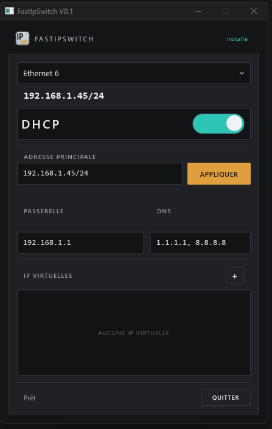
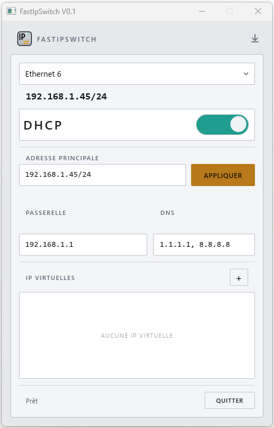
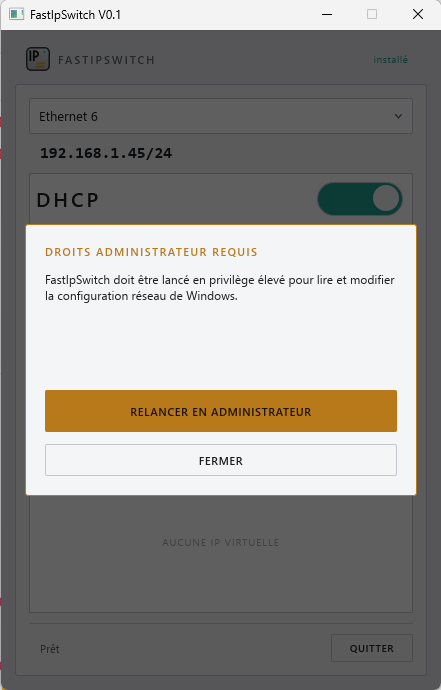

[English](README.md) | **Français**

# FastIpSwitch — V0.1

**Mainteneur :** Valentin PICARD ([@Talevinn](https://codeberg.org/Talevinn))

## Téléchargement

**[Télécharger FastIpSwitch V0.1 pour Windows](https://codeberg.org/Talevinn/FastIpSwitch/releases/download/V0.1/FastIpSwitch-V0.1.exe)** — Windows 10/11, x64, à lancer en administrateur. [Notes de version et SHA-256](https://codeberg.org/Talevinn/FastIpSwitch/releases/tag/V0.1).

Linux se construit depuis les sources : `packaging/build-deb.sh` produit un `.deb` pour Debian/Ubuntu/Mint (voir [Linux](#linux)). Aucun binaire Linux précompilé ni AppImage n'est publié.

FastIpSwitch (Rust + [Slint](https://slint.dev)) est un utilitaire **Windows et Linux** pour **changer rapidement l'adresse IPv4** d'un PC et **ajouter ou retirer à la volée des IP virtuelles**, afin de configurer ou d'interroger du matériel situé sur un autre plan d'adressage : équipements neufs en IP par défaut, anciens équipements en IP fixe, baies de test, matériel AV, etc.

Sous Windows, toutes les modifications réseau passent par **`netsh interface ipv4`** ; le backend et le déroulé Windows sont inchangés. Sous Linux, elles passent par un petit helper privilégié (`nmcli` quand NetworkManager gère l'interface, `ip` sinon). L'interface suit le thème clair/sombre et la langue du système (français/anglais).

| Thème sombre | Thème clair | Sans élévation (Windows) |
|---|---|---|
|  |  |  |

Les captures montrent la version Windows ; Linux utilise la même interface Slint. Aucune capture Linux n'est fournie dans ce dépôt.

## Pourquoi FastIpSwitch

- Un équipement est en `192.168.0.10/24` et ton PC en `192.168.1.45/24` : ajoute une IP virtuelle `192.168.0.50/24` en un clic, sans perdre ta connexion.
- Tu dois basculer ton PC sur un réseau de labo en IP fixe : saisis `192.168.2.10/24`, la passerelle et le DNS, puis **Appliquer**.
- Tu veux revenir immédiatement à la configuration automatique : l'interrupteur **DHCP** ou **Quitter** remet les valeurs par défaut.
- Tu enchaînes les interventions : la liste d'IP virtuelles est mémorisée (désactivée au démarrage) et les adresses temporaires ne restent pas sur l'interface.

## Fonctionnalités

- Sélection de l'adaptateur réseau (les pilotes de filtrage Npcap/QoS/WFP sont masqués).
- Saisie **CIDR** : `192.168.2.10/24` (pas de `255.255.255.0` à taper).
- Adresse principale : DHCP ↔ statique, passerelle et **DNS** optionnels (plusieurs serveurs séparés par des virgules).
- Liste d'IP virtuelles avec interrupteur par ligne, `+` pour ajouter, `×` pour supprimer.
- Interrupteur **DHCP** bidirectionnel : ON = DHCP, OFF = passage en statique avec les valeurs affichées.
- Icône dans la zone de notification : clic pour rouvrir, menu **Afficher / Revenir en DHCP / Quitter**.
- Interface **français/anglais** selon Windows (surcharge possible), thème clair/sombre avec variante « rack ».
- Infobulles sur les icônes et les interrupteurs.
- Journal des commandes netsh et récupération après un arrêt brutal.

## Pourquoi les droits administrateur sont nécessaires sous Windows

Windows n'expose pas d'API utilisateur pour modifier l'adressage IP d'une interface : `netsh interface ipv4` (comme `New-NetIPAddress`) exige un jeton élevé. Sans élévation, les commandes échouent et rien ne change.

FastIpSwitch est donc conçu pour être **lancé élevé**, mais il ne force pas l'UAC au démarrage :

- le manifeste est en `asInvoker` ; sans élévation, l'application s'ouvre quand même, **entièrement grisée**, avec un panneau « Droits administrateur requis » et un bouton **Relancer en administrateur** ;
- les raccourcis créés par l'installateur passent `--elevate` pour demander l'UAC au lancement ;
- le démarrage automatique utilise une **tâche planifiée** `ONLOGON` avec `/RL HIGHEST`, donc élevée au logon, sans prompt UAC.

L'adressage (IP, masque, passerelle, alias) est appliqué en **`store=active`** : la configuration persistante n'est pas modifiée, et un redémarrage rend la configuration enregistrée dans Windows (généralement DHCP). Le **DNS** est l'exception : `netsh set dnsservers` n'accepte pas `store=active`, il est donc écrit de façon persistante puis restauré lors d'un Quitter propre.

## Fonctionnement sous Windows

- **IP virtuelles** : `netsh add address ... skipassource=true store=active`. `skipassource` empêche Windows de choisir ces adresses comme source du trafic sortant, tout en répondant en ARP/ping/HTTP.
- **Coexistence DHCP** : Windows désactive DHCP quand on ajoute une IP manuelle. FastIpSwitch active `dhcpstaticipcoexistence` avant l'ajout pour conserver la connexion DHCP, puis vérifie que DHCP est toujours actif ; sinon l'opération est annulée et DHCP restauré.
- **Adresse principale fixe** : `set address source=static ... store=active`, puis les alias actifs sont réajoutés (cette commande efface les adresses manuelles).
- **DNS** : `set dnsservers source=static` puis `add dnsservers` pour les suivants ; retour à `source=dhcp` lors d'un retour DHCP. Ces commandes n'ont pas de `store=active` : le DNS statique est **persistant**. Il est normalement restauré à la fermeture, mais après un crash suivi d'un reboot sans relancer l'application, il peut rester statique : relance FastIpSwitch ou remets-le manuellement.
- **Rafraîchissement et APIPA** : la sélection d'un adaptateur relit l'état réel. Les adresses `169.254.x.x` (APIPA/link-local) sont ignorées : elles signifient « pas de bail DHCP ». Le champ IP reste vide avec un message, et une vérification toutes les 2 s le remplit quand le bail arrive ; si l'adaptateur courant tombe, l'app bascule vers un adaptateur nouvellement exploitable (sauf si tu as explicitement choisi un adaptateur déconnecté pour le configurer).
- **Validation** : `.0` et `.255` refusés pour un /24 (réseau/diffusion), préfixes plus courts que `/8` refusés, passerelle obligatoirement dans le même sous-réseau, doublons refusés, DNS IPv4 valides.

## Redémarrage, fermeture et récupération sous Windows

| Événement | Ce qui se passe |
|---|---|
| **Croix de la fenêtre** | En mode élevé, réduit dans la zone de notification ; la configuration reste active tant que l'app tourne. Sans admin, la croix ferme l'application. |
| **Quitter** (bouton ou tray) | Supprime les alias, repasse en DHCP, remet le DNS en automatique, puis ferme. Si la restauration échoue, l'app reste ouverte et affiche l'erreur. |
| **Redémarrage Windows** | Retour à la configuration persistante (généralement DHCP), même après un crash. Le DNS statique peut subsister si l'app n'a pas été relancée. |
| **Crash / kill** | `session.toml` est conservé ; au prochain lancement **élevé**, nettoyage ciblé + DHCP. |
| **Lancement sans admin** | Interface grisée + **Relancer en administrateur** ; aucune commande réseau, pas de récupération de session. |
| **Échec d'une commande netsh** | Message d'erreur, rollback de l'ajout, journal dans `data/fastipswitch.log` (ou `%LOCALAPPDATA%`). |

### En cas de problème sous Windows

1. **L'interface est grisée** : clique sur **Relancer en administrateur** (ou clic droit sur l'exe → *Exécuter en tant qu'administrateur*).
2. **Une IP virtuelle ne part pas** : rouvre l'app et désactive l'interrupteur ; sinon redémarre le PC, la configuration persistante revient.
3. **Plus de réseau après une manipulation** : redémarre, ou exécute dans un terminal admin :
   ```cmd
   netsh interface ipv4 set address name="Ethernet 6" source=dhcp store=active
   netsh interface ipv4 set dnsservers name="Ethernet 6" source=dhcp
   netsh interface ipv4 set interface interface="Ethernet 6" dhcpstaticipcoexistence=disabled store=active
   ```
   (remplace `Ethernet 6` par le nom de ton interface ; `netsh interface ipv4 show interfaces` les liste. `set dnsservers` est persistant par nature ; les deux autres commandes utilisent `store=active` pour ne pas figer l'adressage.)
4. **Comprendre ce qui s'est passé** : le journal se trouve dans `data/fastipswitch.log` à côté de l'exe, ou `%LOCALAPPDATA%\FastIpSwitch\fastipswitch.log`. Chaque commande netsh et son résultat y sont écrits (avec rotation).
5. **Réinstaller** : lance la release élevée, clique sur **installé** en haut à droite → **RÉINSTALLER**. Les réglages installés et le choix d'autostart sont préservés.

## Installation sous Windows

### Mode portable (par défaut)

L'exe est autonome (CRT statique, aucune dépendance VC++). Au lancement, s'il peut créer un dossier `data` à côté de l'exécutable, il y stocke `state.toml`, `session.toml` et le journal. Sinon, il utilise `%APPDATA%\FastIpSwitch` et `%LOCALAPPDATA%\FastIpSwitch`.

### Installateur intégré

Lance l'application élevée, puis clique sur l'icône d'installation en haut à droite (ou sur **installé** si déjà installée) :

- copie dans `%LOCALAPPDATA%\Programs\FastIpSwitch` ;
- crée les raccourcis **Bureau** et **Menu Démarrer** avec `--elevate` ;
- option **Lancer au démarrage** (décochée par défaut) → tâche planifiée `FastIpSwitch-<user>`, `ONLOGON`, `/RL HIGHEST` ;
- conserve la liste d'IP virtuelles et le réglage d'autostart lors d'une réinstallation.

Raccourci de développement :

```powershell
pwsh -File tools\install-shortcut.ps1
```

## Utilisation sous Windows

1. Choisir l'adaptateur.
2. **Adresse principale** : saisir `192.168.2.10/24`, la passerelle et le DNS si besoin, puis **Appliquer**.
3. **IP virtuelles** : `+`, saisir `192.168.3.10/24`, activer l'interrupteur. L'IP est ajoutée sans couper DHCP.
4. L'interrupteur **DHCP** : ON = revenir en DHCP, OFF = figer l'adresse affichée en statique.
5. **Quitter** pour tout remettre à zéro.

`192.168.1.0/24` est refusé : `.0` est l'adresse réseau ; il faut une adresse hôte (`.1` à `.254`).

## Langue et thème

- Langue : français si la langue d'interface de Windows est le français, anglais sinon. Surcharge : `FASTIPSWITCH_LANG=fr` ou `en`. Sous Linux, la première valeur non vide parmi `LC_ALL`, `LC_MESSAGES`, `LANG` choisit le français si elle commence par `fr`.
- Thème : suit Windows (rack sombre / aluminium clair). Surcharge : `FASTIPSWITCH_THEME=dark` ou `light`. Sous Linux, détecté depuis GNOME, Cinnamon, XFCE ou KDE, avec repli sur le thème clair.

## Compilation sous Windows

Prérequis : Rust stable récent (≥ 1.88), Visual Studio Build Tools (MSVC), Windows 10/11.

```powershell
cargo build --release
```

Binaire : `target\release\fastipswitch.exe`. `.cargo/config.toml` active `+crt-static` pour un exe autonome. Le manifeste est en `asInvoker` (DPI PerMonitorV2).

## Fichiers sous Windows

| Chemin | Rôle |
|---|---|
| `data\state.toml` / `%APPDATA%\FastIpSwitch\state.toml` | adaptateur, liste d'IP virtuelles, dernier IP/passerelle/DNS |
| `data\session.toml` / `%LOCALAPPDATA%\FastIpSwitch\session.toml` | trace de récupération après crash |
| `data\fastipswitch.log` / `%LOCALAPPDATA%\FastIpSwitch\fastipswitch.log` | journal des commandes netsh (rotation) |
| `%LOCALAPPDATA%\Programs\FastIpSwitch` | installation par utilisateur |

## Limites connues sous Windows

- Pas de gestion des routes statiques (les équipements doivent être sur le même segment L2).
- Le DNS est remis en automatique lors d'un retour DHCP ; la valeur statique précédente n'est pas mémorisée.
- Une seule instance à la fois.
- Installation par utilisateur uniquement (pas d'installation machine-wide).

## Linux

Le portage Linux partage la même interface Slint et le même modèle « adresse principale + IP virtuelles ». C'est un premier portage : couvert par des tests unitaires et un build CI, mais sans matrice de validation matérielle/bureau publiée. **Le backend et le déroulé Windows sont inchangés.** Le guide détaillé (architecture, matrice des commandes, développement, CI) est dans [`docs/linux.fr.md`](docs/linux.fr.md).

NetworkManager est recommandé : les installations de bureau Debian, Ubuntu et Linux Mint l'utilisent par défaut. Le repli dépend de l'état exact rapporté par NetworkManager :

- **gérée et `connected`** : adresse principale, DHCP et DNS passent par `nmcli` ;
- **NetworkManager tourne mais ne gère pas l'interface** (`connected (externally)`, `unmanaged`, `disconnected`, tout état autre que `connected`) : l'adresse statique et le retour DHCP sont **refusés** pour ne pas détruire une configuration externe (networkd, ifupdown…) ; les alias passent toujours par `ip` et les changements DNS par `resolvectl` s'il est présent ;
- **aucun NetworkManager** : l'adresse statique passe par `ip` avec une sauvegarde/restauration en cas d'échec ; le retour DHCP exige `networkctl` (systemd-networkd) et est refusé avant toute modification sinon. Si `networkctl reconfigure` échoue, la configuration précédente est restaurée et l'erreur remonte, sans faux succès.

### Installer le `.deb` (Debian, Ubuntu, Linux Mint)

Aucun paquet Linux précompilé n'est publié : construis le `.deb` depuis les sources, puis installe-le avec `apt` pour résoudre les dépendances.

```sh
packaging/build-deb.sh
sudo apt install ./packaging/.build/dist/fastipswitch_0.1.0_amd64.deb
```

Le paquet installe la GUI dans `/usr/bin/fastipswitch`, le helper dans `/usr/libexec/fastipswitch/fastipswitch-helper` (root:root, `0755`), l'action polkit `/usr/share/polkit-1/actions/org.talevinn.fastipswitch.policy`, l'entrée de bureau, les icônes hicolor, la page de manuel et les métadonnées AppStream. Le build valide la policy (chemin du helper, XML via `xmllint` s'il est installé) et **exige** `dpkg-deb --root-owner-group` ; il s'arrête sinon.

Dépendances d'exécution :

- `iproute2` — indispensable pour la lecture (`ip -j`) et les alias (`ip addr`) ;
- `pkexec | policykit-1` — indispensable pour l'élévation (sur Debian 12/Ubuntu 24.04, `pkexec` est un paquet à part) ;
- `network-manager` — en **Recommends**, installé par défaut par `apt`, nécessaire au chemin `nmcli` ;
- les bibliothèques graphiques listées dans `packaging/deb/DEBIAN/control` : fontconfig, freetype, xkbcommon, Wayland/X11 (y compris les bibliothèques clientes X11), EGL/GL.

Le `.deb` n'est **pas signé** et aucun dépôt APT n'est fourni. Il n'y a **pas d'AppImage** : le helper et la policy polkit doivent être installés au niveau système, ce qu'un fichier portable unique ne fait pas.

### Compiler depuis les sources

Prérequis : Rust stable récent (édition 2024, même chaîne ≥ 1.88 que Windows), `pkg-config` et les en-têtes de développement Slint/winit :

```sh
sudo apt install build-essential pkg-config \
    libfontconfig1-dev libfreetype-dev libxkbcommon-dev \
    libwayland-dev libegl1-mesa-dev libgl1-mesa-dev
cargo build --release
```

`libfreetype-dev` existe sur Debian 12+ et Ubuntu 24.04 ; utilise `libfreetype6-dev` sur les versions plus anciennes. Ajoute `libx11-xcb-dev` pour compiler et lancer sous X11. Binaires : `target/release/fastipswitch` et `target/release/fastipswitch-helper`.

Le helper doit être à un emplacement système pour l'usage normal. Le bouton d'installation de l'application ne gère qu'une copie par utilisateur (`~/.local/bin`, icônes, entrée de bureau, autostart XDG optionnel) et n'installe jamais le helper : utilise le `.deb` pour une élévation fonctionnelle. Si `/usr/bin/fastipswitch` existe (paquet système), il ne copie ni ne modifie `/usr/bin` et ne gère que l'entrée d'autostart.

### Utilisation sous Linux

1. Choisir l'interface. Le loopback et les interfaces de conteneurs/ponts (`docker*`, `veth*`, `virbr*`, `vmnet*`, `br-*`) sont masqués **et refusés par le helper** ; les VPN (`tun*`, `wg*`, …) sont conservés.
2. **Adresse principale** : saisir un CIDR, la passerelle et le DNS si besoin, puis **Appliquer**. Les préfixes plus courts que `/8` sont refusés, ainsi que les adresses réseau/broadcast.
3. **IP virtuelles** : `+`, saisir un CIDR, activer la ligne. Les alias passent toujours par `ip -4 addr add <cidr> dev <if>` et coexistent avec DHCP.
4. **DNS** : appliqué séparément de l'adresse. Avec une connexion NetworkManager gérée : `ipv4.dns` et `ipv4.ignore-auto-dns yes` ; sinon `resolvectl dns <if> …` (obligatoire). Un échec DNS n'annule pas l'adresse et n'arme pas le nettoyage DNS : quitter n'effacera pas une configuration DNS existante.
5. **DHCP** : avec une connexion NetworkManager gérée, le retour lance `nmcli connection up <uuid>`, ce qui efface les surcharges transitoires. Si NetworkManager tourne mais ne gère pas l'interface, le retour est refusé. Sans NetworkManager, le retour exige `networkctl` ; si `networkctl reconfigure` échoue, les adresses et routes précédentes sont restaurées et l'erreur remonte.
6. **Quitter** (ou fermer la fenêtre) retire les alias enregistrés dans la session, remet DHCP et, seulement si le DNS a réellement été appliqué, réinitialise le DNS. Si la restauration échoue, l'app reste ouverte et affiche l'erreur. La fermeture de fenêtre quitte au lieu de masquer : le tray n'est pas garanti sur tous les bureaux.
7. Une seule instance : un `flock` dans `$XDG_RUNTIME_DIR` ; un second lancement s'arrête et affiche un message sur stderr. Une session temporaire est liée à une interface : tant qu'elle est active, les opérations sur une autre interface sont refusées (termine par DHCP/Quitter ou sélectionne cette interface). La récupération après crash conserve la session si l'interface est absente ou si la lecture échoue.

Commandes réellement utilisées :

| Action | NetworkManager `connected` | NM présent, interface non gérée | Aucun NetworkManager |
|---|---|---|---|
| Lecture | `ip -j addr/link/route`, `nmcli connection show --active`, `nmcli -g IP4.DNS device show <if>` | mêmes lectures `ip` ; `connection` vide, DNS lu vide (écriture DNS via `resolvectl`) | mêmes lectures `ip` ; aucune donnée NM |
| Adresse statique | `nmcli device modify <if> ipv4.method manual …` | **refusée** (aucune commande destructive) | `ip` avec instantané : flush/add, restauration si échec |
| Passerelle | `ipv4.gateway` via nmcli | — | posée seulement si l'interface a déjà une route par défaut ou s'il n'en existe aucune ; sinon ignorée. Métrique existante conservée ; une route nouvellement créée utilise la métrique 1000 |
| DHCP | `nmcli connection up <uuid>` | **refusé** | `networkctl` obligatoire ; sauvegarde, flush, reconfigure, restauration si échec |
| DNS | `nmcli device modify <if> ipv4.dns … ipv4.ignore-auto-dns yes` | `resolvectl dns` / `revert` | `resolvectl dns` / `revert` |
| Alias | `ip -4 addr add/del` | `ip -4 addr add/del` | `ip -4 addr add/del` |

### Élévation sous Linux

La GUI tourne sans privilèges et n'obtient jamais root elle-même ; il n'y a pas d'écran « droits administrateur requis » grisé : toute l'interface reste utilisable et chaque modification passe par le helper, avec une seule demande de mot de passe réutilisée quelques minutes.

- L'app sérialise une requête en JSON et lance `pkexec /usr/libexec/fastipswitch/fastipswitch-helper` (`/usr/bin/pkexec` s'il existe, sinon `pkexec` du `PATH`).
- L'action polkit est `org.talevinn.fastipswitch.network` ; `allow_any` et `allow_inactive` sont à `no`, `allow_active` à `auth_admin_keep` : l'élévation est limitée à la session locale active (aucun prompt depuis SSH ou une session inactive), et une seule demande de mot de passe est réutilisée pendant environ cinq minutes pour le processus appelant. Le prompt est générique et n'affiche ni l'interface ni l'IP modifiée.
- Le helper revalide tout avant de toucher au réseau : version du protocole, interface existante dans `/sys/class/net` et différente de `lo`, interfaces virtuelles (`docker*`, `veth*`, `virbr*`, `vmnet*`, `br-*`) refusées, longueur/caractères du nom, invariants du CIDR avec un minimum `/8`, passerelle dans le même sous-réseau, au plus 4 serveurs DNS unicast. Il ne fait jamais confiance à la GUI.
- La requête sur stdin du helper est plafonnée à 64 Kio et doit être de l'UTF-8 valide.
- Les commandes sont exécutées sans shell, avec des arguments séparés.
- Une demande annulée (code 126) ou une autorisation refusée (127) ne change rien et est signalée dans l'interface.
- En release, seul `/usr/libexec/fastipswitch/fastipswitch-helper` est accepté ; `FASTIPSWITCH_HELPER` et un helper voisin de la GUI ne sont pris en compte qu'en debug. `FASTIPSWITCH_DRY_RUN` aussi.

### Fichiers sous Linux

| Chemin | Rôle |
|---|---|
| `~/.config/fastipswitch/state.toml` | interface choisie, liste d'IP virtuelles, dernier IP/passerelle/DNS |
| `~/.local/state/fastipswitch/session.toml` | trace de récupération après crash |
| `~/.local/state/fastipswitch/fastipswitch.log` | journal des commandes (rotation en `.log.1` au-delà de 1 Mo) |
| `$XDG_RUNTIME_DIR/fastipswitch-<uid>.{lock,pid,sock}` | verrou d'instance unique et PID (socket réservé à une activation future) ; sans `XDG_RUNTIME_DIR`, `/tmp/fastipswitch-<uid>/` (`0700`) est utilisé |
| `~/.local/bin/fastipswitch` | installation par utilisateur depuis l'interface, si utilisée |
| `~/.config/autostart/fastipswitch.desktop` | autostart XDG, seulement s'il est activé dans la boîte d'installation |
| `data/` à côté de l'exécutable | mode portable si ce dossier est accessible en écriture (comme sous Windows) |

`XDG_CONFIG_HOME`, `XDG_STATE_HOME`, `XDG_DATA_HOME` et `XDG_RUNTIME_DIR` sont respectés ; les valeurs XDG relatives sont ignorées. Les répertoires de configuration/état sont créés en `0700`, et `state.toml`, `session.toml` et le journal sont en `0600`. `apt remove fastipswitch` ne retire que les fichiers système ; les fichiers utilisateur ci-dessus sont conservés.

### Limites sous Linux

- **Tray sous GNOME** : l'icône utilise le protocole StatusNotifierItem/AppIndicator ; GNOME demande l'extension AppIndicator. Sans elle, utilise la fenêtre (sa fermeture quitte proprement).
- **L'état NetworkManager compte** : si NetworkManager est installé mais ne rapporte pas l'interface comme `connected` (`connected (externally)`, `unmanaged`, `disconnected`), l'adresse statique et le retour DHCP sont refusés par conception ; les alias fonctionnent toujours et les changements DNS passent par `resolvectl`. Si `nmcli device status` échoue lui-même, le helper bascule sur le chemin sans NetworkManager.
- **Pas de backend systemd-networkd complet** : sans NetworkManager, l'adressage statique est un instantané `ip` volatil (restauré en cas d'échec), et le retour DHCP exige `networkctl` ; sans lui, le retour est refusé avant toute modification.
- **Passerelle en repli `ip`** : elle n'est posée que si l'interface a déjà une route par défaut (métrique conservée) ou s'il n'en existe aucune (métrique 1000). Si une autre interface possède l'unique route par défaut, la passerelle est ignorée avec un avertissement sur stderr du helper.
- **Alias volatils** : ils sont ajoutés avec `ip` même sur les interfaces NM et peuvent disparaître quand NetworkManager réapplique ou change le profil ; réactive-les.
- **Pas d'AppImage**, ni Flatpak/Snap, ni dépôt signé : `.deb` uniquement.
- Pas de gestion des routes statiques ni d'IPv6 (IPv4 uniquement, comme sous Windows). Les préfixes plus courts que `/8` et les noms d'interfaces virtuelles sont refusés.
- Une seule instance à la fois ; une session temporaire est liée à une interface, et la session de récupération est conservée si cette interface est absente ou illisible.
- La détection du thème dépend de `gsettings`, `xfconf-query` ou `kreadconfig` ; repli sur le thème clair.
- pkexec a besoin d'un agent polkit et d'une **session locale active** ; l'élévation depuis SSH ou une session inactive est refusée par la policy. L'autorisation est conservée environ cinq minutes pour le processus appelant, et le prompt est générique (ni interface ni IP affichée).

### Dépannage sous Linux

1. **Voir ce que l'app lit** : `fastipswitch --print-adapters` affiche une ligne par interface (`name`, `index`, `mac`, `up`, `dhcp`, `gw`, `dns`, `conn`, adresses) puis quitte ; lecture seule.
2. **Lire le journal** : `~/.local/state/fastipswitch/fastipswitch.log` (ou `data/fastipswitch.log` en mode portable). Les appels `ip`/`nmcli` et les échecs du helper y sont écrits.
3. **Vérifier NetworkManager** : `nmcli device status` (l'interface est-elle exactement `connected`, ou `unmanaged`/`connected (externally)`/`disconnected` ?) et `nmcli -t -f UUID,DEVICE connection show --active` (UUID utilisé par le retour DHCP). Un état autre que `connected` explique un refus d'adresse statique ou de retour DHCP.
4. **Vérifier l'élévation** : `pkexec /usr/libexec/fastipswitch/fastipswitch-helper </dev/null` doit demander le mot de passe (session locale active uniquement) puis renvoyer une erreur JSON (requête vide). « Non autorisé » ou aucune demande peut signifier policy absente, session non locale/inactive ou agent polkit absent. Selon la distribution, les refus sont dans `journalctl -b` ou le journal d'authentification.
5. **Helper introuvable** : vérifie `ls -l /usr/libexec/fastipswitch/fastipswitch-helper` ; en développement, définis `FASTIPSWITCH_HELPER` vers son chemin.
6. **Passerelle ignorée** : en repli `ip`, cela arrive quand une autre interface possède l'unique route par défaut. L'adresse est quand même appliquée ; l'avertissement est sur stderr du helper. Utilise `ip route show default` pour inspecter les métriques.
7. **Session temporaire sur une autre interface** : termine-la par DHCP/Quitter ou sélectionne l'interface indiquée dans le message.
8. **Restaurer manuellement** :
   ```sh
   # NetworkManager : réactive le profil enregistré (efface aussi les surcharges)
   nmcli connection up <uuid>
   # sans NetworkManager (seulement si systemd-networkd gère l'interface)
   sudo ip -4 addr flush dev <if> scope global
   sudo ip route flush default dev <if>
   sudo networkctl reconfigure <if>
   # DNS sans NetworkManager, ou pour le réinitialiser
   sudo resolvectl revert <if>
   # retirer un alias
   sudo ip -4 addr del <cidr> dev <if>
   ```
   Si `networkctl reconfigure` échoue, réapplique les adresses/routes précédentes depuis le journal ou le profil enregistré de ta distribution ; ne laisse pas l'interface sans configuration.
9. **Désinstaller** : `sudo apt remove fastipswitch` (ou `apt purge`). La configuration et les journaux utilisateur ne sont pas supprimés ; efface `~/.config/fastipswitch` et `~/.local/state/fastipswitch` pour repartir de zéro.

### Voir aussi

- [Guide Linux détaillé](docs/linux.fr.md) — architecture, protocole, matrice complète des commandes, développement et CI.
- [État multiplateforme](docs/cross-platform.fr.md) — ce qui est commun, ce qui est spécifique, état de macOS.
- [Notes de packaging](packaging/README.md) — contenu du `.deb`, variables de build, dépendances d'exécution.

## Licence

GPL-3.0-or-later — voir `LICENSE` et `NOTICE`.
