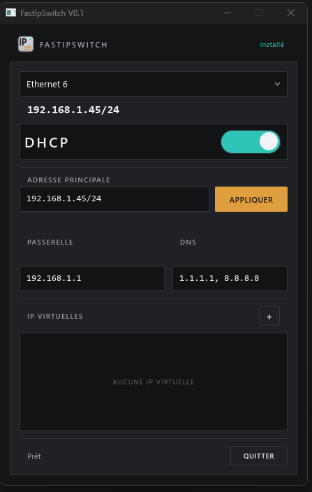
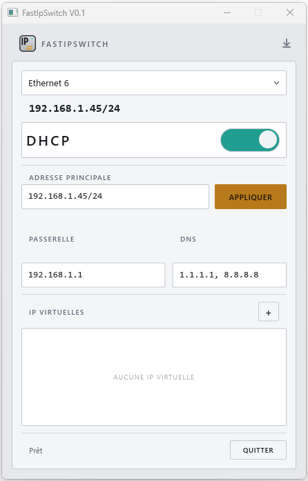
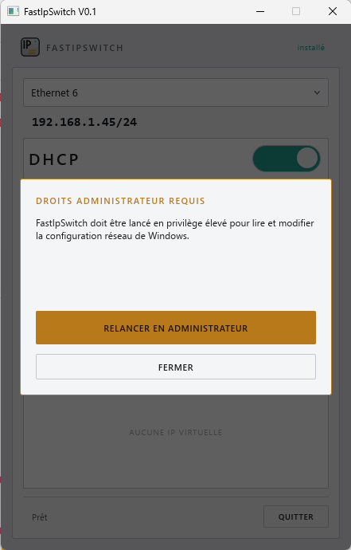

**English** | [Français](README.fr.md)

# FastIpSwitch — V0.1

**Maintainer:** Valentin PICARD ([@Talevinn](https://codeberg.org/Talevinn))

## Download

**[Download FastIpSwitch V0.1 for Windows](https://codeberg.org/Talevinn/FastIpSwitch/releases/download/V0.1/FastIpSwitch-V0.1.exe)** — Windows 10/11, x64, run as administrator. [Release notes and checksum](https://codeberg.org/Talevinn/FastIpSwitch/releases/tag/V0.1).

Linux is built from source: `packaging/build-deb.sh` produces a `.deb` for Debian/Ubuntu/Mint (see [Linux](#linux)). No prebuilt Linux binary or AppImage is published.

FastIpSwitch (Rust + [Slint](https://slint.dev)) is a **Windows and Linux** utility to **switch the IPv4 address quickly** and **add or remove virtual IPs on the fly**, so you can commission or interrogate equipment that sits on a different subnet: brand-new devices still on their default IP, legacy gear with a hard-coded address, test benches, AV hardware, etc.

On Windows, all network changes go through **`netsh interface ipv4`**; the Windows backend and workflow are unchanged. On Linux, they go through a small privileged helper (`nmcli` when NetworkManager manages the interface, `ip` otherwise). The UI follows the system light/dark theme and language (English/French).

| Dark theme | Light theme | Without elevation (Windows) |
|---|---|---|
|  |  |  |

Screenshots show the Windows build; Linux uses the same Slint layout. There is no Linux screenshot in this repository.

## Why FastIpSwitch

- A device is on `192.168.0.10/24` while your PC is on `192.168.1.45/24`: add a virtual IP `192.168.0.50/24` in one click, without losing your connection.
- You need to put your PC on a lab network with a fixed address: enter `192.168.2.10/24`, the gateway and DNS, then **Apply**.
- You want to return to automatic configuration immediately: the **DHCP** switch or **Quit** restores the defaults.
- You move from one job to the next: the virtual IP list is remembered (disabled at startup), and temporary addresses do not stay behind.

## Features

- Network adapter selector (filter drivers such as Npcap/QoS/WFP are hidden).
- **CIDR** input: `192.168.2.10/24` (no `255.255.255.0` to type).
- Primary address: DHCP ↔ static, optional gateway and **DNS** (several servers separated by commas).
- Virtual IP list with a per-row enable switch, `+` to add, `×` to remove.
- Bidirectional **DHCP** switch: ON = DHCP, OFF = static mode using the displayed values.
- Notification-area icon: click to reopen, menu **Show / Back to DHCP / Quit**.
- **English/French** UI based on Windows (override available), light/dark theme with a rack-inspired variant.
- Tooltips on icons and switches.
- netsh command log and crash recovery.

## Why administrator rights are required on Windows

Windows does not expose a user-level API to change an interface's IP configuration: `netsh interface ipv4` (like `New-NetIPAddress`) requires an elevated token. Without elevation, the commands fail and nothing changes.

FastIpSwitch is therefore designed to run **elevated**, but it does not force UAC at startup:

- the manifest is `asInvoker`; without elevation, the app still opens, **fully greyed out**, with an “Administrator rights required” panel and a **Restart as administrator** button;
- shortcuts created by the installer pass `--elevate` to request UAC at launch;
- automatic startup uses a **scheduled task** `ONLOGON` with `/RL HIGHEST`, so it runs elevated at sign-in without a UAC prompt.

The app applies addressing (IP, mask, gateway, aliases) in **`store=active`**: the persistent configuration is not modified, and a reboot restores the configuration stored in Windows (usually DHCP). **DNS is the exception**: `netsh set dnsservers` has no `store=active`, so it is written persistently and restored on a clean Quit.

## How it works on Windows

- **Virtual IPs**: `netsh add address ... skipassource=true store=active`. `skipassource` keeps Windows from choosing those addresses as the source for outbound traffic, while still answering ARP/ping/HTTP.
- **DHCP coexistence**: Windows disables DHCP when a manual IP is added. FastIpSwitch enables `dhcpstaticipcoexistence` before the add to keep the DHCP connection, then checks that DHCP is still active; otherwise the operation is cancelled and DHCP restored.
- **Static primary address**: `set address source=static ... store=active`, then active aliases are re-added (this command clears manual addresses).
- **DNS**: `set dnsservers source=static` plus `add dnsservers` for additional servers; back to `source=dhcp` on a DHCP restore. These commands have no `store=active`, so static DNS is **persistent**. It is normally restored on exit, but after a crash followed by a reboot without relaunching the app it may remain static: relaunch FastIpSwitch or reset it manually.
- **Adapter refresh and APIPA**: selecting an adapter re-reads the live state. `169.254.x.x` (APIPA/link-local) is ignored: it means there is no DHCP lease. The IP field is left empty with a hint, and a 2-second background check fills it in when a lease arrives; if the current adapter goes down, the app switches to a newly usable adapter (unless you explicitly selected a disconnected adapter to configure it).
- **Validation**: `.0` and `.255` are rejected for a /24 (network/broadcast), prefixes shorter than `/8` are rejected, the gateway must be in the same subnet, duplicates are rejected, DNS entries must be valid IPv4.

## Restart, quit and failure recovery on Windows

| Event | What happens |
|---|---|
| **Window close button** | In elevated mode, minimizes to the notification area; configuration stays active while the app runs. Without admin, it quits. |
| **Quit** (button or tray) | Removes aliases, switches back to DHCP, resets DNS, then exits. If restore fails, the app stays open and shows the error. |
| **Windows restart** | Returns to the persistent configuration (usually DHCP), even after a crash. Static DNS may remain if the app was not relaunched. |
| **Crash / kill** | `session.toml` is kept; on the next **elevated** launch, targeted cleanup + DHCP restore. |
| **Launch without admin** | Greyed UI + **Restart as administrator**; no network command, no session recovery. |
| **netsh failure** | Error message, rollback of the add, log in `data/fastipswitch.log` (or `%LOCALAPPDATA%`). |

### If something goes wrong on Windows

1. **The UI is greyed out**: click **Restart as administrator** (or right-click the exe → *Run as administrator*).
2. **A virtual IP will not go away**: reopen the app and switch it off; otherwise reboot, the persistent configuration returns.
3. **No network after a manipulation**: reboot, or run in an elevated terminal:
   ```cmd
   netsh interface ipv4 set address name="Ethernet 6" source=dhcp store=active
   netsh interface ipv4 set dnsservers name="Ethernet 6" source=dhcp
   netsh interface ipv4 set interface interface="Ethernet 6" dhcpstaticipcoexistence=disabled store=active
   ```
   (replace `Ethernet 6` with your interface name; `netsh interface ipv4 show interfaces` lists them. `set dnsservers` is persistent by nature; the other two use `store=active` so addressing is not frozen.)
4. **Understand what happened**: the log is in `data/fastipswitch.log` next to the exe, or `%LOCALAPPDATA%\FastIpSwitch\fastipswitch.log`. Every netsh command and its result is written there (with rotation).
5. **Reinstall**: launch the elevated release, click **installed** at the top right → **REINSTALL**. Installed settings and the autostart choice are preserved.

## Installation on Windows

### Portable mode (default)

The exe is self-contained (static CRT, no VC++ dependency). At startup, if it can create a `data` folder next to the executable, it stores `state.toml`, `session.toml` and the log there. Otherwise it uses `%APPDATA%\FastIpSwitch` and `%LOCALAPPDATA%\FastIpSwitch`.

### Built-in installer

Launch the app elevated, then click the install icon at the top right (or **installed** if already installed):

- copies to `%LOCALAPPDATA%\Programs\FastIpSwitch`;
- creates **Desktop** and **Start Menu** shortcuts with `--elevate`;
- optional **Start with Windows** (unchecked by default) → `FastIpSwitch-<user>` scheduled task, `ONLOGON`, `/RL HIGHEST`;
- preserves the existing virtual IP list and the autostart setting on reinstall.

Development shortcut:

```powershell
pwsh -File tools\install-shortcut.ps1
```

## Usage on Windows

1. Select the adapter.
2. **Primary address**: enter `192.168.2.10/24`, the gateway and DNS if needed, then **Apply**.
3. **Virtual IPs**: `+`, enter `192.168.3.10/24`, enable the switch. The IP is added without dropping DHCP.
4. The **DHCP** switch: ON = return to DHCP, OFF = freeze the displayed address as static.
5. **Quit** to restore everything.

`192.168.1.0/24` is rejected: `.0` is the network address; use a host address (`.1` to `.254`).

## Language and theme

- Language: English unless the Windows UI language is French; override with `FASTIPSWITCH_LANG=fr` or `en`. On Linux, the first non-empty value among `LC_ALL`, `LC_MESSAGES`, `LANG` selects French when it starts with `fr`.
- Theme: follows Windows (dark rack / light aluminium). Override with `FASTIPSWITCH_THEME=dark` or `light`. On Linux, detected from GNOME, Cinnamon, XFCE or KDE settings, falling back to light.

## Build on Windows

Requirements: recent stable Rust (≥ 1.88), Visual Studio Build Tools (MSVC), Windows 10/11.

```powershell
cargo build --release
```

Binary: `target\release\fastipswitch.exe`. `.cargo/config.toml` enables `+crt-static` for a self-contained exe. The manifest is `asInvoker` (DPI PerMonitorV2).

## Files on Windows

| Path | Purpose |
|---|---|
| `data\state.toml` / `%APPDATA%\FastIpSwitch\state.toml` | adapter, virtual IP list, last IP/gateway/DNS |
| `data\session.toml` / `%LOCALAPPDATA%\FastIpSwitch\session.toml` | crash-recovery trace |
| `data\fastipswitch.log` / `%LOCALAPPDATA%\FastIpSwitch\fastipswitch.log` | netsh command log (rotated) |
| `%LOCALAPPDATA%\Programs\FastIpSwitch` | per-user installation |

## Known limitations on Windows

- No static route management (devices must be on the same L2 segment).
- DNS is reset to automatic on a DHCP restore; the previous static value is not remembered.
- One instance at a time.
- Per-user installation only (no machine-wide install).

## Linux

The Linux port shares the same Slint UI and the same "primary address + virtual IPs" model. It is an initial port: covered by unit and integration tests run locally, but without a published hardware/desktop test matrix. **The Windows backend and workflow are unchanged.** A detailed guide (architecture, command matrix, development, local tests) is in [`docs/linux.md`](docs/linux.md).

NetworkManager is recommended: Debian, Ubuntu and Linux Mint desktop installs use it by default. The fallback depends on the exact state reported by NetworkManager:

- **managed and `connected`**: primary address, DHCP and DNS use `nmcli`;
- **NetworkManager runs but does not manage the interface** (`connected (externally)`, `unmanaged`, `disconnected`, any state other than `connected`): static address and DHCP restore are **refused** to avoid destroying an external configuration (networkd, ifupdown, …); aliases still use `ip`, and DNS changes use `resolvectl` when present;
- **no NetworkManager at all**: static address uses `ip` with a snapshot/restore on failure; DHCP restore requires `networkctl` (systemd-networkd) and is refused before touching anything otherwise. A failed `networkctl reconfigure` restores the previous configuration and reports the error instead of pretending success.

### Install the `.deb` (Debian, Ubuntu, Linux Mint)

No prebuilt Linux package is published: build the `.deb` from the sources, then install it with `apt` so dependencies are resolved.

```sh
packaging/build-deb.sh
sudo apt install ./packaging/.build/dist/fastipswitch_0.1.0_amd64.deb
```

The package installs the GUI in `/usr/bin/fastipswitch`, the helper in `/usr/libexec/fastipswitch/fastipswitch-helper` (root:root, `0755`), the polkit action `/usr/share/polkit-1/actions/org.talevinn.fastipswitch.policy`, the desktop entry, hicolor icons, the man page and AppStream metadata. The build validates the policy (helper path, and XML via `xmllint` when installed) and **requires** `dpkg-deb --root-owner-group`; it stops otherwise.

Runtime dependencies:

- `iproute2` — required for reading (`ip -j`) and aliases (`ip addr`);
- `pkexec | policykit-1` — required for elevation (on Debian 12/Ubuntu 24.04, `pkexec` is its own package);
- `network-manager` — **Recommends**, installed by default by `apt`, needed for the `nmcli` path;
- the GUI libraries listed in `packaging/deb/DEBIAN/control`: fontconfig, freetype, xkbcommon, Wayland/X11 (including the X11 client libraries), EGL/GL.

The `.deb` is **not signed** and no APT repository is provided. There is **no AppImage**: the helper and the polkit policy have to be installed system-wide, which a single portable file does not do.

### Build from source

Requirements: recent stable Rust (edition 2024, same ≥ 1.88 toolchain as Windows), `pkg-config`, and the Slint/winit development headers:

```sh
sudo apt install build-essential pkg-config \
    libfontconfig1-dev libfreetype-dev libxkbcommon-dev \
    libwayland-dev libegl1-mesa-dev libgl1-mesa-dev
cargo build --release
```

`libfreetype-dev` is available on Debian 12+ and Ubuntu 24.04; use `libfreetype6-dev` on older releases. Add `libx11-xcb-dev` to build and run under X11. Binaries: `target/release/fastipswitch` and `target/release/fastipswitch-helper`.

The helper must end up in a system path for normal use. The in-app install button only handles a per-user copy (`~/.local/bin`, icons, desktop entry, optional XDG autostart) and never installs the helper: use the `.deb` for a working elevation setup. When `/usr/bin/fastipswitch` exists (system package), it does not copy or chmod `/usr/bin` and only manages the autostart entry.

### Usage on Linux

1. Select the interface. Loopback and container/bridge interfaces (`docker*`, `veth*`, `virbr*`, `vmnet*`, `br-*`) are hidden **and rejected by the helper**; VPN interfaces (`tun*`, `wg*`, …) are kept.
2. **Primary address**: enter a CIDR, optional gateway and DNS, then **Apply**. Prefixes shorter than `/8` are rejected, as are network/broadcast addresses.
3. **Virtual IPs**: `+`, enter a CIDR, enable the row. Aliases always use `ip -4 addr add <cidr> dev <if>` and coexist with DHCP.
4. **DNS**: applied separately from the address. With a managed NetworkManager connection: `ipv4.dns` and `ipv4.ignore-auto-dns yes`; otherwise `resolvectl dns <if> …` (required). A DNS failure does not roll back the address and does not arm DNS cleanup: quitting will not erase an existing DNS configuration.
5. **DHCP**: with a managed NetworkManager connection, switching back runs `nmcli connection up <uuid>`, which clears transient overrides. If NetworkManager runs but does not manage the interface, the restore is refused. Without NetworkManager, the restore requires `networkctl`; if `networkctl reconfigure` fails, the previous addresses and routes are restored and the error is reported.
6. **Quit** (or closing the window) removes the aliases recorded in the session, restores DHCP and, only if DNS was actually applied, resets DNS. If restoration fails, the app stays open and shows the error. Closing the window quits rather than hiding: the tray is not guaranteed on every desktop.
7. One instance at a time: a `flock` in `$XDG_RUNTIME_DIR`; a second launch exits and prints a message on stderr. A temporary session is bound to one interface: while it is active, operations on another interface are refused (finish with DHCP/Quit or select that interface). Crash recovery keeps the session when the interface is missing or the adapter read fails.

What is actually run:

| Action | NetworkManager `connected` | NM running, interface not managed | No NetworkManager |
|---|---|---|---|
| Read | `ip -j addr/link/route`, `nmcli connection show --active`, `nmcli -g IP4.DNS device show <if>` | same `ip` reads; `connection` empty, DNS read empty (DNS writes via `resolvectl`) | same `ip` reads; no NM data |
| Static address | `nmcli device modify <if> ipv4.method manual …` | **refused** (no destructive command) | `ip` with snapshot: flush/add, restore on failure |
| Gateway | `ipv4.gateway` via nmcli | — | set only if this interface already has a default route or no default route exists; otherwise ignored. Existing metric kept; a newly created route uses metric 1000 |
| DHCP | `nmcli connection up <uuid>` | **refused** | `networkctl` required; backup, flush, reconfigure, restore on failure |
| DNS | `nmcli device modify <if> ipv4.dns … ipv4.ignore-auto-dns yes` | `resolvectl dns` / `revert` | `resolvectl dns` / `revert` |
| Alias | `ip -4 addr add/del` | `ip -4 addr add/del` | `ip -4 addr add/del` |

### Elevation on Linux

The GUI runs unprivileged and never obtains root itself, and there is no greyed-out administrator screen: the whole interface stays usable and each modification goes through the helper, with a single password prompt reused for a few minutes.

- The app serializes one request to JSON and launches `pkexec /usr/libexec/fastipswitch/fastipswitch-helper` (`/usr/bin/pkexec` when present, otherwise `pkexec` from `PATH`).
- The polkit action is `org.talevinn.fastipswitch.network`; `allow_any` and `allow_inactive` are `no`, `allow_active` is `auth_admin_keep`: elevation is limited to the local active session (no prompt from SSH or an inactive session), and one password prompt is reused for about five minutes for the calling process. The prompt is generic and does not show the interface or IP being changed.
- The helper revalidates everything before touching the network: protocol version, interface exists in `/sys/class/net` and is not `lo`, virtual interfaces (`docker*`, `veth*`, `virbr*`, `vmnet*`, `br-*`) are rejected, name length/allowed characters, CIDR invariants including a `/8` minimum, gateway in the same subnet, at most 4 unicast DNS servers. It never trusts the GUI.
- The helper request on stdin is capped at 64 KiB and must be valid UTF-8.
- Commands are executed without a shell, with separate arguments.
- A cancelled prompt (exit code 126) or a refused authorization (127) changes nothing and is reported in the UI.
- In release builds, only `/usr/libexec/fastipswitch/fastipswitch-helper` is accepted; `FASTIPSWITCH_HELPER` and a helper next to the GUI are honoured in debug builds only. `FASTIPSWITCH_DRY_RUN` is also debug-only.

### Files on Linux

| Path | Purpose |
|---|---|
| `~/.config/fastipswitch/state.toml` | selected adapter, virtual IP list, last IP/gateway/DNS |
| `~/.local/state/fastipswitch/session.toml` | crash-recovery trace |
| `~/.local/state/fastipswitch/fastipswitch.log` | command log (rotated to `.log.1` above 1 MB) |
| `$XDG_RUNTIME_DIR/fastipswitch-<uid>.{lock,pid,sock}` | single-instance lock and PID (socket reserved for future activation); without `XDG_RUNTIME_DIR`, `/tmp/fastipswitch-<uid>/` (`0700`) is used |
| `~/.local/bin/fastipswitch` | per-user install from the UI, if used |
| `~/.config/autostart/fastipswitch.desktop` | XDG autostart, only if enabled in the install dialog |
| `data/` next to the executable | portable mode when that directory is writable (same as Windows) |

`XDG_CONFIG_HOME`, `XDG_STATE_HOME`, `XDG_DATA_HOME` and `XDG_RUNTIME_DIR` are honoured; relative XDG values are ignored. The config/state directories are created `0700`, and `state.toml`, `session.toml` and the log are `0600`. `apt remove fastipswitch` removes system files only; the user files above are kept.

### Linux limitations

- **Tray on GNOME**: the icon uses the StatusNotifierItem/AppIndicator protocol; GNOME needs the AppIndicator extension. Without it, use the window (closing it quits cleanly).
- **NetworkManager state matters**: if NetworkManager is installed but does not report the interface as `connected` (`connected (externally)`, `unmanaged`, `disconnected`), static address and DHCP restore are refused by design; aliases still work and DNS changes use `resolvectl`. If `nmcli device status` itself fails, the helper falls back to the no-NetworkManager path.
- **No complete systemd-networkd backend**: without NetworkManager, static addressing is a volatile `ip` snapshot (restored on failure), and DHCP restore requires `networkctl`; without it the restore is refused before any change.
- **Gateway on the `ip` fallback**: it is applied only when the interface already has a default route (same metric kept) or when no default route exists (metric 1000). If another interface owns the only default route, the gateway is ignored with a helper stderr warning.
- **Aliases are volatile**: they are added with `ip` even on NM interfaces, and can disappear when NetworkManager reapplies or changes the profile; re-enable them.
- **No AppImage**, no Flatpak/Snap, no signed repository; `.deb` only.
- No static route management and no IPv6 configuration (IPv4 only, as on Windows). Prefixes shorter than `/8` and virtual interface names are rejected.
- One instance at a time; a temporary session is bound to one interface, and the recovery session is kept if that interface is missing or cannot be read.
- Theme detection depends on `gsettings`, `xfconf-query` or `kreadconfig`; falls back to light.
- pkexec needs a polkit authentication agent and an **active local session**; elevation from SSH or an inactive session is denied by policy. The authorization is kept about five minutes for the calling process, and the prompt is generic (no interface/IP shown).

### Troubleshooting on Linux

1. **List what the app sees**: `fastipswitch --print-adapters` prints one line per interface (`name`, `index`, `mac`, `up`, `dhcp`, `gw`, `dns`, `conn`, addresses) and exits; it only reads.
2. **Read the log**: `~/.local/state/fastipswitch/fastipswitch.log` (or `data/fastipswitch.log` in portable mode). It records `ip`/`nmcli` calls and helper failures.
3. **Check NetworkManager**: `nmcli device status` (is the interface exactly `connected`, or `unmanaged`/`connected (externally)`/`disconnected`?) and `nmcli -t -f UUID,DEVICE connection show --active` (UUID used by the DHCP restore). A non-`connected` state explains a refused static address or DHCP restore.
4. **Check elevation**: `pkexec /usr/libexec/fastipswitch/fastipswitch-helper </dev/null` should prompt (local active session only) and then return a JSON error (empty request). "Not authorized" or no prompt can mean the policy is missing, the session is not local/active, or no polkit agent is running. Depending on the distribution, refusals are in `journalctl -b` or the authentication log.
5. **Helper not found**: check `ls -l /usr/libexec/fastipswitch/fastipswitch-helper`; in development, set `FASTIPSWITCH_HELPER` to its path.
6. **Gateway ignored**: on the `ip` fallback, this happens when another interface has the only default route. The address is still applied; the warning is on the helper stderr. Use `ip route show default` to inspect metrics.
7. **Temporary session on another interface**: finish it with DHCP/Quit or select the interface named in the message.
8. **Restore manually**:
   ```sh
   # NetworkManager: reactivate the saved profile (also clears transient overrides)
   nmcli connection up <uuid>
   # without NetworkManager (only if systemd-networkd manages the interface)
   sudo ip -4 addr flush dev <if> scope global
   sudo ip route flush default dev <if>
   sudo networkctl reconfigure <if>
   # DNS without NetworkManager, or to reset it
   sudo resolvectl revert <if>
   # remove one alias
   sudo ip -4 addr del <cidr> dev <if>
   ```
   If `networkctl reconfigure` fails, re-apply the previous addresses/routes from the log or your distribution's saved profile; do not leave the interface without configuration.
9. **Uninstall**: `sudo apt remove fastipswitch` (or `apt purge`). User configuration and logs are not deleted; remove `~/.config/fastipswitch` and `~/.local/state/fastipswitch` to start from scratch.

### See also

- [Detailed Linux guide](docs/linux.md) — architecture, protocol, full command matrix, development and local tests.
- [Cross-platform status](docs/cross-platform.md) — what is shared, what is platform-specific, macOS status.
- [Packaging notes](packaging/README.md) — `.deb` contents, build variables, runtime dependencies.

## License

GPL-3.0-or-later — see `LICENSE` and `NOTICE`.
